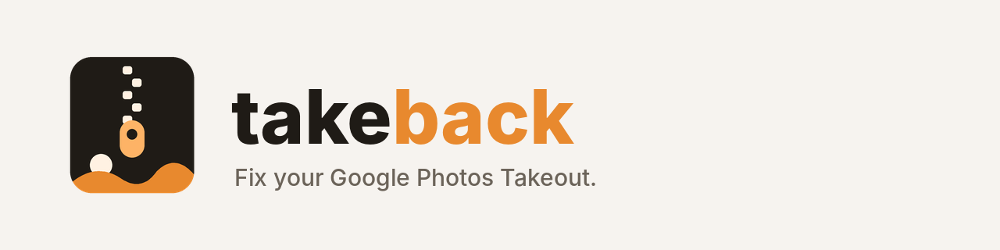

<picture>
  <source media="(prefers-color-scheme: dark)" srcset="docs/images/readme-banner-dark-1280x320.png">
  
</picture>

Not affiliated with Google.

# Takeback

Takeback restores dates, locations, descriptions, and favorites from Google
Photos Takeout JSON sidecars and organizes the exported photos on your computer.
It preserves the original media files and does not recompress them.

Takeback runs locally. It does not send your photos, metadata, or usage data
anywhere; the app makes no network requests and includes no telemetry.

## Screenshots

Screenshots will be added when release builds are available.

## Download and install

Download an installer for your operating system from this project's GitHub
Releases.

- **Windows:** Run the `.msi` or `.exe` installer. The v1 builds are unsigned,
  so Windows SmartScreen may show a warning. Verify that you downloaded the
  installer from this project's Releases before choosing **More info** and
  **Run anyway**.
- **macOS:** Open the `.dmg` and move Takeback to Applications. The v1 builds
  are unsigned; if Gatekeeper blocks the app, Control-click it and choose
  **Open**, then confirm. Alternatively, remove quarantine from a trusted
  download with `xattr -dr com.apple.quarantine /Applications/Takeback.app`.
- **Linux:** Make the AppImage executable (`chmod +x Takeback*.AppImage`) and
  run it. A `.deb` package is also provided for Debian-based distributions.
  macOS and Linux need a system Perl installation for ExifTool.

## Build from source

Install Node.js LTS, Rust, and the platform prerequisites for Tauri 2. On
Ubuntu/Debian, install `libwebkit2gtk-4.1-dev`, `build-essential`, `curl`,
`wget`, `file`, `libxdo-dev`, `libssl-dev`, `libayatana-appindicator3-dev`,
`librsvg2-dev`, and `patchelf`.

```sh
npm ci
npm run tauri:dev
```

Run the test suites with:

```sh
npm run build
cargo test --manifest-path src-tauri/Cargo.toml
```

## Privacy and affiliation

Your Takeout data stays on your computer. Takeback has no telemetry and does
not make network requests. Takeback is an independent project and is not
affiliated with, endorsed by, or sponsored by Google.

## License

Takeback is distributed under the MIT License. See [LICENSE](LICENSE).
