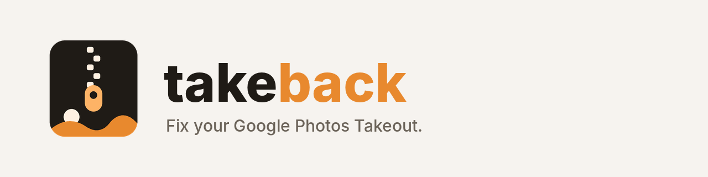

# Takeback brand and icon pack

The mark is the zip card on a transparent background. **Dark card** is for light backgrounds, **light card** is for dark backgrounds.

## Use this
- **App icon:** copy `tauri-icons-dark/icons/` into `src-tauri/icons/` (it is the dark card). Prefer the cream card? Use `tauri-icons-light/icons/` instead. To rebuild from a source file: `npm run tauri icon app-icon/app-icon-dark-1024.png`.
- `tauri.conf.json` icon list: `"icons/32x32.png", "icons/128x128.png", "icons/128x128@2x.png", "icons/icon.icns", "icons/icon.ico"`.
- **Why dark is the default app icon:** Explorer, Finder and the Start menu are usually light. On a dark taskbar the card body disappears, but the orange pull and sun stay visible.

## What is where
| Folder | Contents | Used for |
|---|---|---|
| `svg/` | mark light/dark, mono black/white, horizontal lockups | master files, README, docs |
| `png/` | marks at 16 to 1024 px (light, dark), mono 512 | anywhere you need a PNG |
| `tauri-icons-dark/`, `tauri-icons-light/` | complete `icons/` folder: 32x32, 128x128, 128x128@2x, icon.png, icon.ico, icon.icns, Square*Logo.png, StoreLogo.png | Windows, macOS, Linux app icon |
| `app-icon/` | 1024 px sources | `tauri icon` command |
| `linux/` | 16 to 512 px PNGs named `takeback-N.png`, `takeback.svg` | hicolor icon theme, AppImage, deb |
| `tray/` | color tray icons (light/dark, 16 to 32 px); macOS `trayTemplate.png` and `@2x` (black, transparent) | system tray |
| `favicon/` | favicon.ico/png, apple-touch-icon, android-chrome, webmanifest, mask-icon | a website or GitHub Pages |
| `github/` | social preview 1280x640 (light, dark), README banners (light, dark), avatar | GitHub repo |
| `installer/` | NSIS header and sidebar BMPs, WiX banner and dialog BMPs, DMG background (+@2x) | Windows and macOS installers |
| `in-app/` | `logo-mark-*.svg`, `about-512.png` | About dialog, in-app logo |

## Platform notes
- **macOS tray:** use the `trayTemplate` files and `icon_as_template(true)`; macOS tints them for light and dark menu bars. macOS icons use the padded version, so the card is not oversized in the Dock.
- **Windows tray:** use `tray-light-*` on a dark taskbar and `tray-dark-*` on a light one.
- **Installers:** in `tauri.conf.json` point `bundle.windows.nsis.headerImage` and `sidebarImage`, `bundle.windows.wix.bannerPath` and `dialogImagePath`, and the macOS dmg background to these files. Check the Tauri docs for the current key names.
- **Favicon, apple-touch and android icons** sit on a cream tile because those platforms require an opaque image.

## GitHub
Repo Settings, General, Social preview: upload `github/social-preview-1280x640.png`. README header that follows light and dark mode:
```html
<picture>
  <source media="(prefers-color-scheme: dark)" srcset="github/readme-banner-dark-1280x320.png">
  
</picture>
```

## Colors
Light orange `#FDB366` · deep orange `#E8892E` · dark orange `#B8530A` · cream `#F6F3EF` · card cream `#FFF8F0` · ink `#1F1B16`.

## Open item: wordmark font
The brand font is Bricolage Grotesque, but it is not installed where these files were made. The PNG banners and installer images use Inter ExtraBold as a stand-in. The SVG lockups reference Bricolage as live text. To match exactly, outline the SVG text in Inkscape or Figma, or send the font file so the wordmark can be converted to outlines and the PNGs redone.
